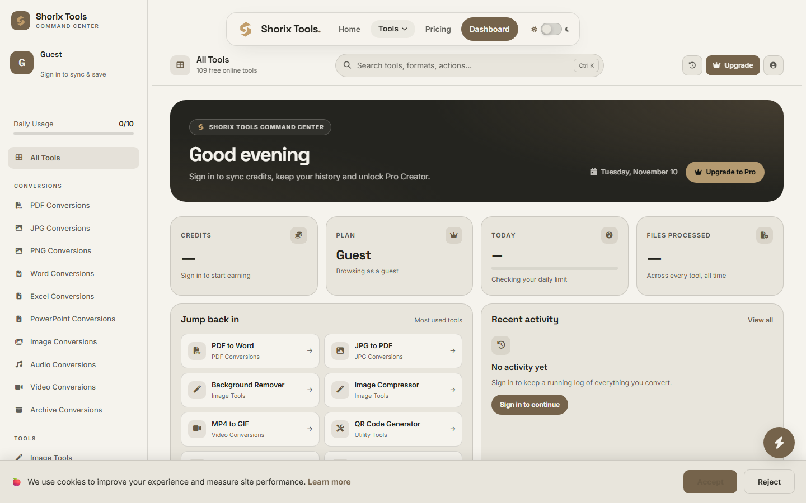
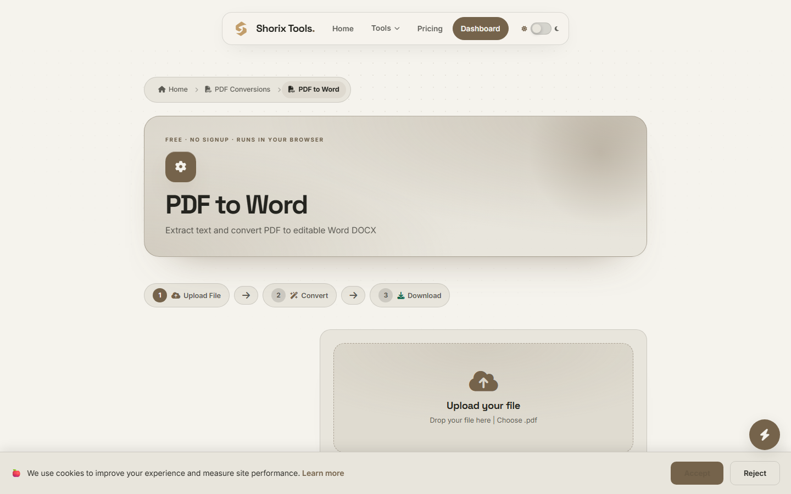
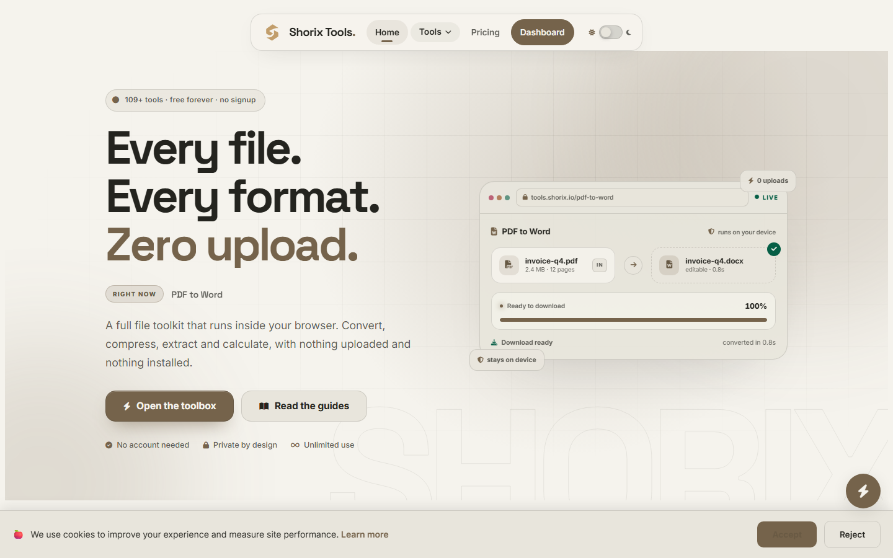
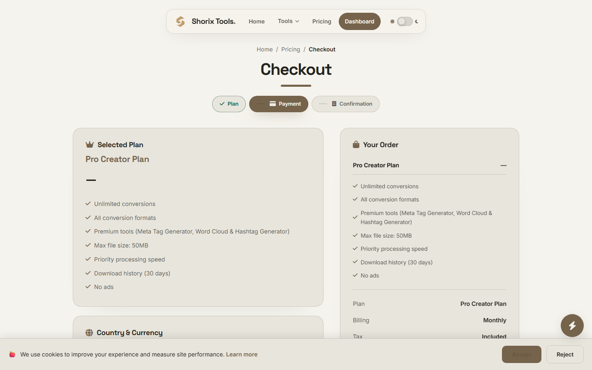

# Shorix Tools

**Every file. Every format. Zero upload.**

109+ free online tools for PDF conversion, image editing, audio/video processing, text utilities, calculators and more — all running directly in your browser.

---

## About

Shorix Tools is a comprehensive web-based toolkit with 109+ free online tools for file conversion, image editing, audio/video processing, text utilities, calculators and more. No signup, no installation — every tool runs inside your browser, so your files are never uploaded anywhere.

## Features

- **PDF Tools** — Convert, extract, merge and split PDFs (PDF to Word, JPG, PNG, Excel, PowerPoint and more)
- **Image Tools** — Background remover, compressor, format converter, upscaler, watermark remover
- **Audio & Video** — Convert between MP3, WAV, AAC, FLAC, OGG, M4A / MP4, WebM, AVI, MOV, MKV; extract audio; create GIFs
- **Text & Writing** — Word counter, case converter, grammar checker, plagiarism checker, lorem ipsum
- **Utilities** — QR code generator/scanner, barcode tools, password generator, unit & timezone converters
- **Calculators** — BMI, scientific, percentage and more
- **Guest-first dashboard** — open the full toolbox without an account; sign in only when you buy credits or a membership
- **Multi-currency pricing** — PKR, USD, EUR and GBP with automatic detection; JazzCash and bank transfer accepted
- **Payment status lookup** — every payment gets an `SX-` code you can track anytime
- **Responsive + dark mode** — full theme support with system preference detection

## Screenshots

### Homepage

### Dashboard

### Pricing

### PDF to Word

### Tools menu

### Checkout

## Tech Stack

| Layer | Technology |
|-------|-----------|
| Frontend | Next.js 15, React 19, Tailwind CSS 4, TypeScript |
| Backend | Node.js, MySQL (mysql2) |
| Auth | JWT, email OTP |
| Email | Resend |
| Payments | JazzCash, bank transfer |
| Monitoring | Sentry, Google Analytics, AdSense |
| Deployment | Hostinger (Linux) |

## Key Highlights

- **109+ tools across 16 categories** — one of the largest free online toolkits
- **No signup required** — tools work instantly in your browser
- **Files never leave your device** — conversions run locally (zero upload)
- **Credit system** — free tier with daily conversions, Pro plan for unlimited
- **Support desk** — tickets, suggestions and a helpful chatbot
- **Admin panel** — analytics, user management, tool control and payment verification

## Live

**[tools.shorix.io](https://tools.shorix.io)**

---

Made with care

