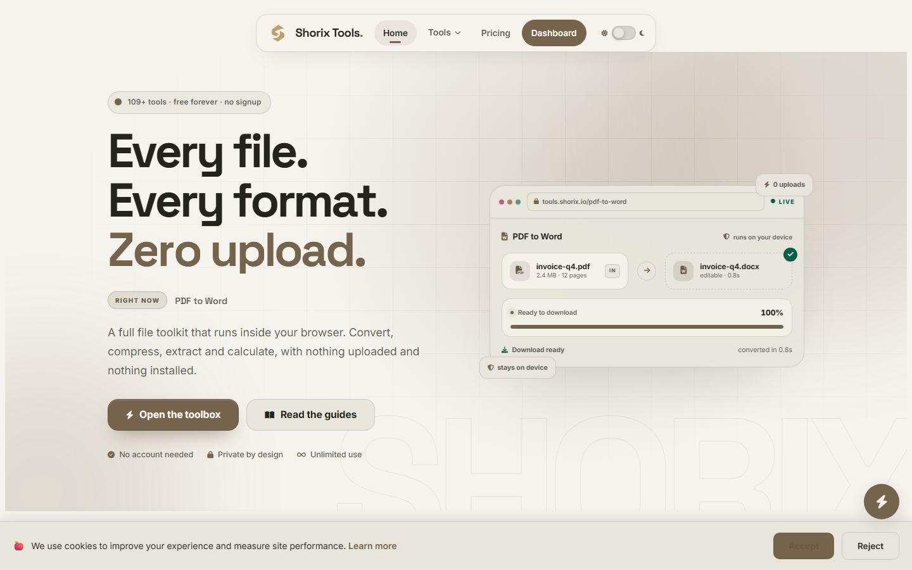
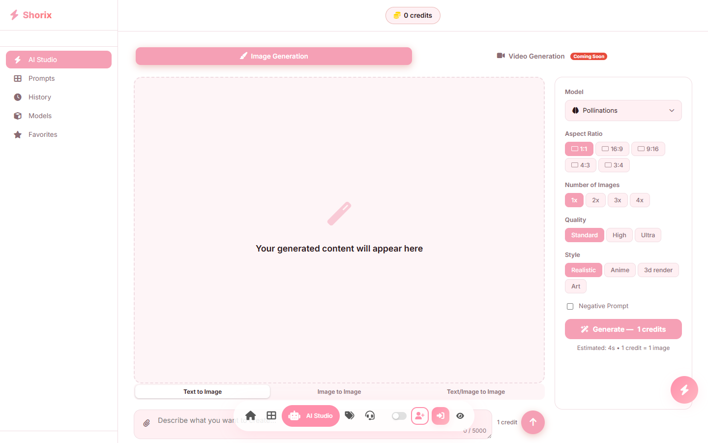
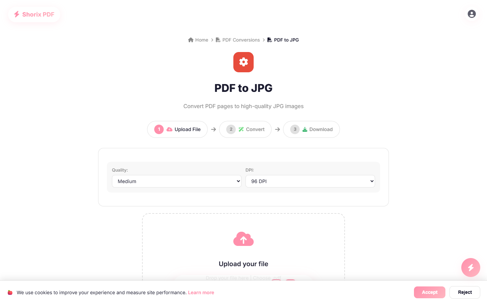

# Shorix

**Extract. Convert. Dominate.**

Pakistan's most powerful all-in-one online toolkit — 100+ free tools for PDF conversion, image editing, audio/video processing, AI generation, and more.

---

## About

Shorix is a comprehensive web-based toolkit that provides 100+ free online tools for file conversion, image editing, audio/video processing, AI-powered generation, calculators, and more. No signup, no installation required — all tools run directly in your browser.

## Features

- **PDF Tools** — Convert, extract, merge, split PDFs (PDF to Word, JPG, PNG, Excel, and more)
- **Image Tools** — Background remover, compressor, format converter, watermark remover
- **Audio Tools** — Convert between MP3, WAV, AAC, FLAC, OGG, M4A
- **Video Tools** — Convert between MP4, WebM, AVI, MOV, MKV; extract audio; create GIFs
- **AI Studio** — AI image generation with multiple models (Pollinations, HuggingFace, Cloudflare Workers AI)
- **Calculators** — Scientific calculator, BMI calculator, and more
- **AI Chatbot** — Powered by Gemini with Groq fallback
- **Admin Dashboard** — Full analytics, user management, and tool control panel

## Screenshots

### Homepage

### AI Studio

### PDF to JPG Converter

### Pricing

## Tech Stack

| Layer | Technology |
|-------|-----------|
| Frontend | Next.js 15, React 19, Tailwind CSS 4 |
| Backend | Node.js, MySQL (mysql2) |
| AI | HuggingFace, Cloudflare Workers AI, Gemini, Groq |
| Auth | JWT, Google OAuth, GitHub OAuth, Firebase Phone Auth |
| Email | Resend |
| Payments | JazzCash integration |
| Monitoring | Sentry |
| Deployment | Hostinger (Linux) |

## Key Highlights

- **100+ tools** — one of the largest free online toolkits from Pakistan
- **No signup required** — most tools work without registration
- **Credit system** — free tier with 10 conversions/day, Pro plan for unlimited
- **Admin panel** — real-time analytics, user management, support tickets
- **Responsive design** — works on desktop, tablet, and mobile
- **Dark mode** — full theme support with system preference detection

## Live

**[shorix.io](https://shorix.io)**

---

Built with care from Pakistan

